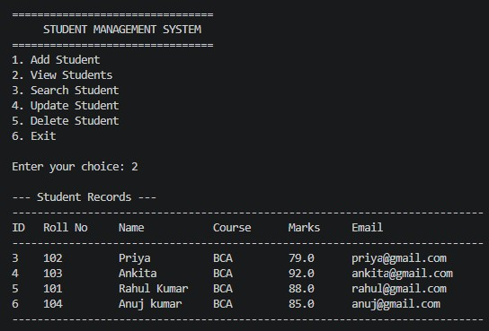

## 🌐 Live Demo

Try the Student Management System online: [**Open Live Website**](https://ankitasonal84.pythonanywhere.com/)

> This project is built using Python, Flask, SQLite, HTML, and CSS.
# Student Management System

A simple console-based Student Management System developed using Python and SQLite.

## Features

- Add student records
- View all students
- Search students by roll number
- Update student details
- Delete student records
- Input validation
- Delete confirmation

## Technologies Used

- Python
- SQLite
- VS Code

## Concepts Used

- Python functions
- SQL and SQLite database
- CRUD operations
- Exception handling
- Input validation
- Conditional statements
- Loops

## How to Run

1. Install Python.
2. Clone this repository.
3. Open the project folder in VS Code.
4. Run:

```bash
python main.py
```

## Demo



## Author

Ankita Sonal
